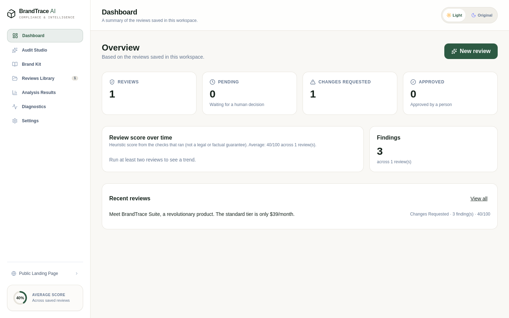
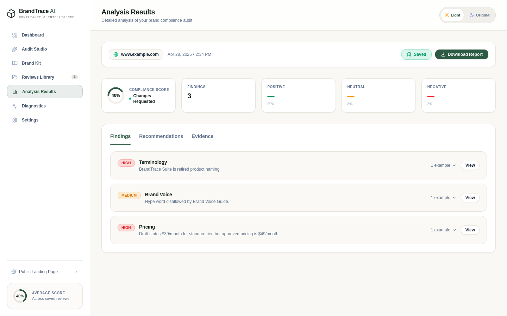
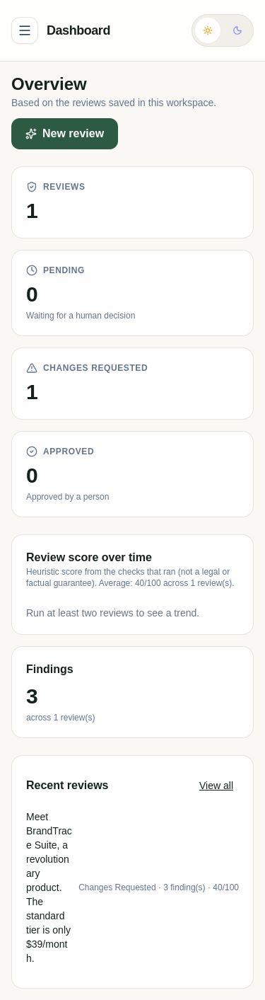

# BrandTrace AI

Checks marketing copy against your brand rules **before it is published**. Every finding quotes the exact text, explains
the problem and cites the approved source. A person, never the checker, makes the final approval decision.

> **Live demo:** https://brandtrace-app.onrender.com (free tier: the first load can take about a minute, and saved data
> is lost on restart). All brand information in the demo is **fictional sample data**.

| Dashboard (real saved reviews) | Review results |
|---|---|
|  |  |

<p></p>

*Screenshots are captured from the running app with one sample review. Every number on screen is computed from saved
reviews; nothing is simulated.*

## What it does
- **Brand Kit** in SQLite: prohibited names with replacements, tier prices, hype-word limits, required claims, and
  approved reference sources. CSV/JSON import with preview and validation. Source effective/expiry dates with warnings.
- **Rule checks** (`src/server/checker.ts`): normalises quotes and dashes, flags near-miss typos of banned names, parses USD and INR
  prices, and avoids false alarms on other tiers or third-party prices.
- **Optional AI analysis** (Gemini, OpenAI-compatible or Anthropic) through server-side keys; the app runs without one and says so.
- **Human approval flow:** Pending Review, Changes Requested, Approved, with comments and an **audit trail**.
  A draft with no findings is *Pending Review*, and a workspace with no rules says that nothing was checked.
- **Check API** (`POST /api/v1/check`): per-workspace API keys, rules only, draft not stored. See [docs/api.md](docs/api.md).
- **Document upload** (TXT, DOCX, text PDF) to extract text before a review, and **Delete My Data**.

## Honest status
| Area | Status |
|---|---|
| Type-check, 25 tests, production build | Pass (run in CI config; the workflow itself has not run on GitHub yet) |
| Real-browser check, headless Chromium on Linux | 16 checks pass: review privacy between browsers, real data only, no horizontal overflow at 320/375/768/1440px, no console errors |
| Rule accuracy | Held-out synthetic set: precision 100%, recall 91.3%. See Evaluation below. **Not** a real-world accuracy figure |
| AI analysis with a live model | **Not verified.** Use Diagnostics > Test connection after setting your key |
| Accounts and roles | **Not built.** The workspace id is chosen by the browser and is not authentication |

## Privacy model
- Reviews in the shared `demo` workspace are stored **per browser** (anonymous client id), so visitors do not see each other's drafts.
- Other workspaces are separated by id only. Anyone who guesses an id can read that workspace: do not store confidential material until real login exists.
- With an AI provider configured, the draft and retrieved source text are sent to that provider.
- Data is stored unencrypted in SQLite.

## Security controls
- `POST /api/config` and `/api/test-connection` need `ADMIN_TOKEN` (header `x-admin-token`); without it they are disabled in production. API keys are never returned to the browser.
- API keys are only sent to allow-listed https hosts (extend with `ALLOWED_LLM_HOSTS`).
- CORS is same-origin unless `CORS_ORIGINS` lists exact origins. Request bodies are limited to 2 MB; uploads to 5 MB.
- AI calls are capped globally per hour and per day (`LLM_MAX_CALLS_PER_HOUR`, `LLM_MAX_CALLS_PER_DAY`); the counters are shared by all visitors and reset on restart. There is no per-user limit yet.
- Drafts and API keys are not written to logs.

## Evaluation
Two evaluations exist, and they measure different things:

- **Real checker, held-out set** (`npm run eval:checker`, report in `evaluation/checker_report.md`): runs the shipped
  `src/server/checker.ts` on 30 synthetic drafts that were **not** used to tune the rules. Latest run: precision
  100% (21/21), recall 91.3% (21/23), 0 of 10 clean drafts falsely flagged. The two misses are a price written as
  "USD 45 a month" and the hype variant "game-changing".
- **Original 50-draft benchmark** (`npm run eval`): scores a **Python re-implementation** of the rules
  (`scripts/evaluate_dataset.py`), not the TypeScript code, and the rules were improved while looking at these same
  drafts. Its 100% is therefore not independent evidence. The drafts are also scored on the real checker in the report above.

All data is synthetic, written by one annotator, and covers only the fictional demo-workspace rules. These figures
do **not** estimate accuracy on real marketing copy, and **no result exists yet for the LLM analysis**.

## 🚀 Quick Start

### Installation & Run
```bash
# Install dependencies
npm install

# Start development server
npm run dev
# Server runs on http://localhost:3000
```

### Running the Evaluation Benchmark
```bash
python3 scripts/evaluate_dataset.py
```
Outputs are recorded in `evaluation/evaluation_report.md`, `evaluation/baseline_results.json`, and `evaluation/improved_results.json`.

---

## Company-use features
- **Workspace-scoped reviews in SQLite**: each workspace sees only its own reviews. "Delete My Data" removes the workspace's reviews, audit log and API keys.
- **Human approval stays human**: the checker never sets "Approved". No findings gives "Pending Review", and a workspace with no rules says nothing was checked.
- **Audit trail** (`GET /api/audit`): review created, re-run, status changes with comments, deletions, API checks and key events.
- **Check API** (`POST /api/v1/check`): per-workspace API keys, rules only, draft not stored. See [docs/api.md](docs/api.md).
- **Source dates**: effective and expiry dates with warnings for expired or soon-to-expire sources.
- **CI**: `.github/workflows/ci.yml` runs lint, tests, the checker evaluation and the build (not yet run on GitHub).

## Browser check
`npm run build`, then follow the header of [scripts/browser-check.mjs](scripts/browser-check.mjs) (Linux, headless Chromium).

## Known limitations
- On Render's free tier the SQLite file is ephemeral, so reviews, audit entries and API keys are lost on restart.
- Reviews from before this version lived in an unscoped JSON file; they are not migrated (they had no workspace owner).
- There are no user accounts or roles. The workspace id is chosen by the client, so it separates data but is **not authentication**: anyone who guesses an id can read that workspace's reviews. The audit trail records the workspace, not a person.
- The audit trail and API-key management have API endpoints but **no screen yet**; source expiry is surfaced on the dashboard only. API keys can only be created by the server admin via the API.
- Expired sources produce a warning only; their rules are still enforced.
- Keyword-fallback analysis has no sentiment model; voice and visibility scores are `null` unless an AI provider returns them.
- Gemini model availability and your API key have not been verified by the maintainer's tests; use "Test connection" after deploying.
- No automated test covers the HTTP routes, and the real-browser check (`scripts/browser-check.mjs`) is run by hand, not in CI.

## ☁️ Deployment

See [DEPLOYMENT.md](DEPLOYMENT.md) for step-by-step instructions for deploying to **Render**, **Railway**, or **Vercel**.
- **Free Tier SQLite Notice**: Free container hosts use ephemeral filesystems. Unmounted SQLite files will reset to seed data when containers spin down or restart. Attach a persistent volume for durable multi-day storage.
